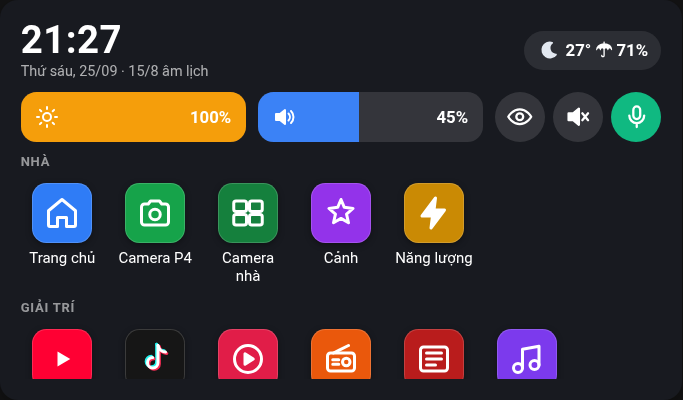
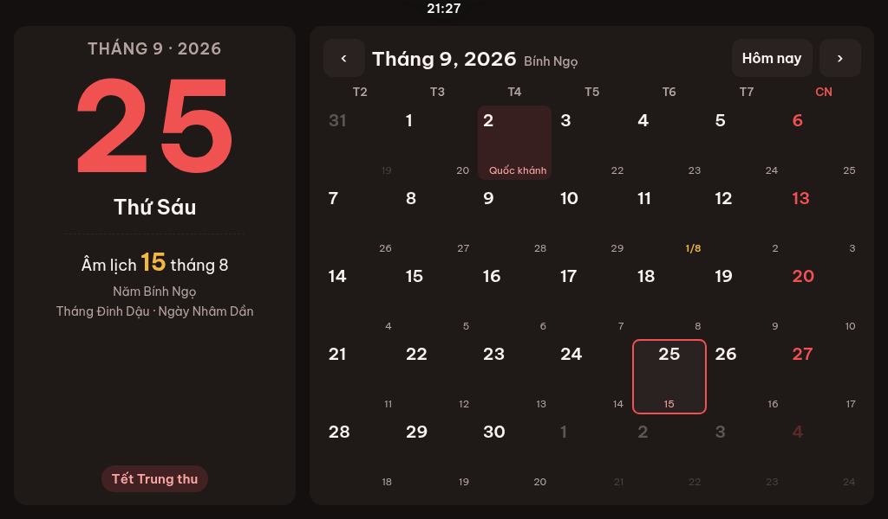
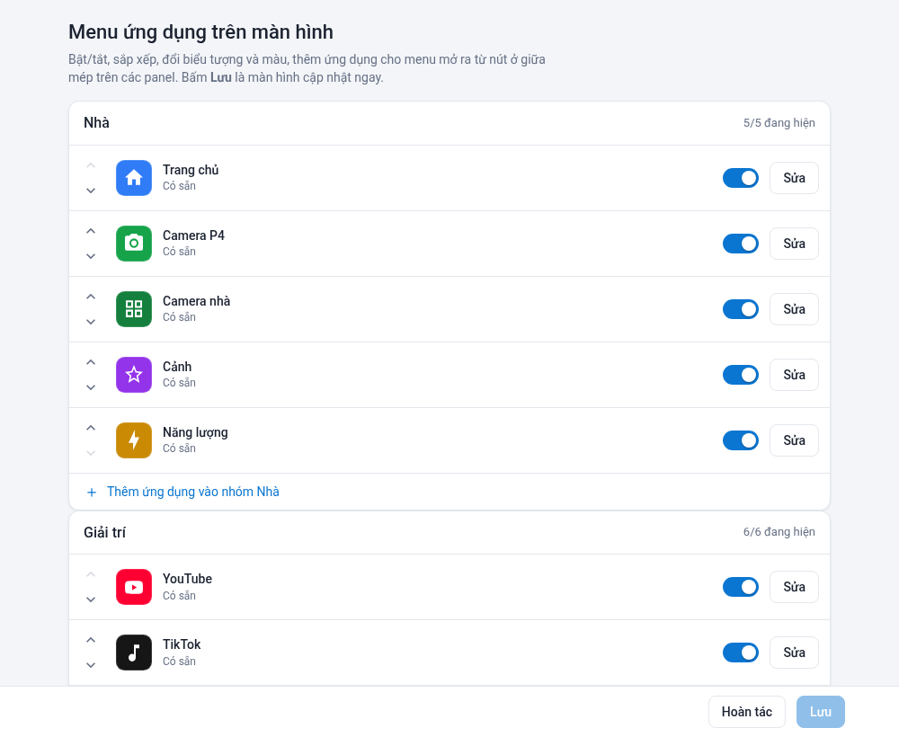

# HA Darboard Server — Remote WebView Server

Biến màn hình cảm ứng **ESP32-P4 / ESP32-S3** thành **bảng điều khiển gắn tường kiểu điện thoại** cho Home Assistant.
Một Chrome ẩn chạy trên máy chủ dựng trang web (dashboard HA, YouTube, camera, ứng dụng của dự án), gửi phần thay đổi
dưới dạng ô ảnh JPEG qua WebSocket tới màn hình, nhận lại thao tác chạm. Trên đó là một "hệ điều hành" nhỏ: màn hình
chính, dock, thanh trạng thái kéo xuống, thông báo, tin nhắn nội bộ, báo thức, âm thanh theo loại, màn hình chờ…

Dự án gồm hai repo dùng cùng nhau:

| Repo | Vai trò | Phiên bản hiện tại (16/10/2026) |
|---|---|---|
| **HA-Darboard-Server** (repo này) | Máy chủ — addon Home Assistant (hoặc container Docker) | **2.9.171** |
| [HA-Darboard-Client](https://github.com/minhquanghp86/HA-Darboard-Client) | Firmware màn hình (ESPHome) + YAML mẫu chung (một file, nhiều thiết bị) | tag **`fw-2026.10.22`** |

> Tài liệu bàn giao / báo cáo nội bộ được giữ riêng (không công khai).

Đã chạy thật hằng ngày trên ba màn hình: **ESP32-P4 1024×600** (Guition JC1060P470C — có camera, micro, loa),
**ESP32-S3 480×480** (Guition 4848S040) và **ESP32-S3 480×272** (Guition JC4827W543C) — hai màn S3 không có loa/camera.

📖 **Hướng dẫn sử dụng đầy đủ** (cài từ đầu, dùng hằng ngày, tự động hoá, xử lý sự cố):
[`hassio/remote_webview_server/DOCS.md`](hassio/remote_webview_server/DOCS.md) — cũng ở tab *Tài liệu* của addon.
Nhật ký thay đổi từng phiên bản: [`CHANGELOG.md`](hassio/remote_webview_server/CHANGELOG.md).


<p align="center">
  
  
  
  
</p>

## Tính năng

### Hiển thị và truyền hình

- Chrome ẩn (có giải mã **H.264**) dựng trang; chỉ gửi các ô **thay đổi** (so khớp băm từng ô), khung đầy đủ khi vùng
  đổi lớn; bỏ khung trùng; không có màn hình nào xem thì không mã hoá.
- **Tự điều tiết** nhịp khung và chất lượng JPEG theo thời gian giải mã thật của từng màn hình và độ nghẽn WiFi.
- **ESP32-P4**: khung đầy đủ chia dải ngang, giải mã phần cứng thẳng vào framebuffer — YouTube đủ 1024×600 ~25–29
  hình/giây đo thực tế.
- **ESP32-S3**: khung video nửa độ phân giải + phóng ×2 trên chip — YouTube 480×480 ~14 hình/giây (trước 1,9).
- **Mỗi ứng dụng một tab Chromium riêng**: chuyển ứng dụng không tải lại; tab nền vẫn chạy (nhạc/radio phát nền), tab
  rảnh lâu tự đóng và còn trong *Gần đây*. Renderer Chrome bị hệ điều hành giết (hết RAM) thì tab tự nạp lại.
- **YouTube không quảng cáo** (2.9.132, mặc định BẬT — tắt riêng từng màn ở *Cài đặt → YouTube*): trên tab YouTube /
  YouTube TV đang hiện, máy chủ kiểm mỗi 1,5 s và tự **bỏ qua quảng cáo** (bấm “Bỏ qua” nếu có, tua hết quảng cáo không có
  nút) và tự chọn **“Xem ở chế độ khách”** trên YouTube TV (chạm thật qua CDP).

### Giao diện kiểu điện thoại

- **Màn hình chính**: đồng hồ lớn, ngày âm dương, thời tiết (Open-Meteo, tự thử lại khi lỗi, nhớ số liệu qua khởi động
  lại); lưới ứng dụng nhiều trang, **thư mục**, kéo thả sắp xếp; **dock** tối đa 6 ứng dụng (mặc định Home Assistant,
  Camera, YouTube, Tin nhắn, NhacCuaTui, Google Maps).
- **Cử chỉ**: vuốt lên từ mép dưới = về màn hình chính; vuốt lên rồi giữ = **Gần đây**; vuốt từ mép trái/phải = quay lại;
  kéo từ mép trên = **thanh trạng thái**.
- **Thanh trạng thái**: độ sáng, âm lượng (Media / Thông báo / Báo thức), nút Màn hình chờ, Im lặng, Không làm phiền,
  Khử vọng mic, hàng *Phát hiện người* (P4), thẻ *Đang phát*, danh sách thông báo, lối tắt (Camera, Frigate, Gần đây,
  Cài đặt, Trợ lý…).
- **Màn hình chờ / màn khóa**: đồng hồ hoặc **khung ảnh số** (ảnh gia đình/Google Photos, hiệu ứng, ban đêm tông tối) sau
  một lúc rảnh; không bao giờ đè lên video đang phát. Góc trên phải có **thanh trạng thái kiểu điện thoại** (tin nhắn /
  thông báo / báo thức kèm số, mạng Wi-Fi hoặc cáp, **pin của màn**). Widget: thời tiết, **6 chỉ số năng lượng** (PV hôm nay,
  công suất PV, tải hôm nay, tiêu thụ lưới, tiêu thụ tải, pin % kèm sạc/xả), lịch, lần camera Frigate phát hiện (~5 s),
  và **thẻ đỏ "Cuộc gọi nhỡ"** (chuông cổng / gọi giữa các màn) kèm ảnh khách. Màn có cảm biến người (P4): **còn người
  đứng trước màn hình thì không vào màn hình chờ**, chỉ đếm thời gian rảnh từ lúc cảm biến báo trống.
- **Pin kiểu điện thoại** (firmware có `battery_monitor.h`): tự biết có lắp pin hay không, đang sạc / cắm nguồn / dùng pin —
  pin xanh có tia sét khi sạc, phích cắm khi chạy nguồn ngoài; không còn báo % ảo khi không lắp pin.
- **YouTube TV**: vuốt = phím mũi tên như remote, cử chỉ quay lại = Esc. **Truyền YouTube từ điện thoại** như Smart TV
  (DIAL/SSDP), tên màn hình khi truyền đổi được trong Cài đặt.
- **Bàn phím ảo** tiếng Việt (Telex) tự hiện khi chạm ô nhập.

### Ứng dụng

| Nhóm | Ứng dụng |
|---|---|
| Liên lạc | **Gọi** (gọi video giữa các màn / với trình duyệt), **Chuông cổng** (nhật ký 30 ngày) |
| Nhà | Home Assistant, **Camera** (chụp/quay của chính P4), **Frigate** (lưới camera go2rtc), **Thư viện** + **Quản lý file** (thẻ SD), Phòng, Điều khiển, Solar |
| Giải trí | **IPTV**, YouTube, YouTube TV, YouTube Music, TikTok, Radio VOV, Tin tức, VTVgo, Zing MP3, NhacCuaTui, Media, Khung ảnh |
| Tiện ích | **Tin nhắn**, **Báo thức**, Hẹn giờ, Thời tiết, Lịch âm dương, Việc cần làm, Hôm nay, Bảng tin, Báo Mới, Giá vàng, Xổ số, Google Maps, Trình duyệt, **Cài đặt** |

Ứng dụng **Camera** chỉ có trên màn có camera (**P4**). **Thư viện** + **Quản lý file** có trên màn có thẻ nhớ — **P4**
(SDMMC) và **S3 4848S040** (thẻ SPI, component `sd_files`, từ 2.9.129). Thêm/ẩn/sắp xếp/đổi biểu tượng ở trang **Darboard**
trên thanh bên Home Assistant.

### Tin nhắn nội bộ

- Nhắn giữa trang **Darboard** (thanh bên HA — mỗi tài khoản HA một người, **ảnh đại diện** lấy từ `person.*`) và các
  màn hình: chữ, ảnh, video, **tin nhắn thoại giữ-để-ghi** (micro P4), tạo/xoá cuộc trò chuyện, nhóm.
- **Đã xem riêng từng màn hình**; chấm đỏ + huy hiệu số tin chưa đọc; nhiều tin cùng cuộc trò chuyện gộp một thông báo.
- "Đang xem" chỉ khi ứng dụng đang hiện, không có màn hình chờ đè lên và có người chạm trong 2 phút — không thì tin mới
  vẫn có chuông + thẻ thông báo.
- Tin từ màn hình bắn sự kiện HA `darboard_chat_message` (dùng cho tự động hoá).

### Trang "Darboard" (thanh bên Home Assistant)

- **Trang chủ kiểu điện thoại**: thẻ rút gọn từng màn ở đầu trang + lưới biểu tượng ứng dụng (Màn hình, Tin nhắn có huy
  hiệu số tin chưa đọc, IPTV, Quản lý file, Màn khóa, Chuông cổng, Gọi, Menu ứng dụng). Mỗi ứng dụng có nút **‹ Trang chủ**.
- **Màn hình** (2.9.161): điều khiển + cài đặt từng màn từ xa — ảnh màn đang hiển thị, trạng thái (mạng, pin, độ sáng, âm
  lượng, ứng dụng, thông báo, cuộc gọi nhỡ), thao tác (đánh thức, màn hình chờ, khóa, về màn chính / HA, tải lại, khởi động
  lại), trình phát (phát / tạm dừng / tua / kênh trước-sau / dừng), mở / đóng ứng dụng, gửi thông báo, đọc to, mọi cài đặt.
- **Màn khóa**: ô *Xem trước màn khóa* (6 chỉ số năng lượng như trên màn, số liệu trực tiếp) + chọn cảm biến theo từng dòng;
  lịch Google / iCal.
- **Menu ứng dụng**: ô *Xem trước menu trên màn* (lưới biểu tượng theo nhóm, bấm để sửa); bật / tắt, sắp xếp, đổi tên,
  biểu tượng, màu, thêm ứng dụng.

### Quản lý file (thẻ SD) trên trang Darboard

- Thẻ **Quản lý file** trên trang Darboard (thanh bên HA, qua đăng nhập HA — dùng được cả ngoài nhà): duyệt thẻ, xem ảnh /
  phát video, **tải về** (tệp gốc hoặc **MP4** — máy chủ đổi .mkv sang MP4 trong vài giây, không nén lại hình), **tải lên**
  từ điện thoại / máy tính (tuỳ chọn **tối ưu video 720p** cho màn hình, nhận cả HEVC của điện thoại), đổi tên, tạo thư mục,
  xoá nhiều. Chép vào thẻ ~0,7–0,85 MB/s, **tạm dừng khi màn hình đang phát video**. Chỉ liệt kê màn **đang có thẻ** (rút
  thẻ ra thì màn đó biến khỏi danh sách); nhiều màn có thẻ thì có ô chọn màn, chỉ một màn thì ghi tên màn cạnh "Thẻ SD".

### IPTV + phát từ trang Darboard

- **Danh sách kênh M3U** (đường link, `.m3u` trong `/media` của HA, hoặc tệp trên thẻ nhớ của màn — `sd:/…`): kênh hiện
  trong ứng dụng **IPTV** của mọi panel; tự cập nhật 6 giờ/lần (nút **Tải lại kênh** để cập nhật ngay; mất mạng dùng bản
  đã lưu). Quản lý danh sách nằm sau nút ⚙ **Danh sách kênh**.
- **Trang IPTV của Darboard**: hàng **trạng thái từng màn** (Đang phát kênh gì / IPTV chạy nền / Không phát) với nút
  **Dừng** và **Màn chính**; ô **tìm kênh** (gõ không dấu vẫn ra); chip **Yêu thích** (dùng chung mọi màn) · **Gần đây**
  (kênh phát từ Darboard + kênh xem trên màn) · **Tất cả** · từng danh sách, chọn nhóm; lưới thẻ kênh có logo và ngôi sao.
  Chạm thẻ → chọn **một màn** hoặc **Tất cả màn hình** để phát, hoặc **Xem trong trình duyệt**.
- API: `GET /iptv/screens`, `GET /iptv/status`, `POST /iptv/cast {dev, ch, name?}` (`dev` = id màn hoặc `all`),
  `POST /iptv/control {dev, act: "stop"|"home"}`.
- Phát được HLS / MPEG-TS / FLV qua HTTP / `.mp4` / DASH + ClearKey; **không** phát DRM Widevine/PlayReady, `udp://`,
  `rtmp://`, H.265/MPEG-2. Máy chủ làm proxy luồng (`/iptv/p`) để gắn `Referer`/`User-Agent` riêng từng kênh và tránh CORS.

### Âm thanh kiểu điện thoại

- Âm thanh trang web (YouTube, radio…) bắt qua PulseAudio, gửi PCM 16 kHz tới màn hình có loa.
- Ba loại âm lượng: **Media** (trang web), **Thông báo** (chuông tin nhắn/thông báo, chuông cửa, TTS của HA),
  **Báo thức** (báo thức, hẹn giờ, cảnh báo khẩn). P4 tự phát chuông bằng tệp nhúng trong firmware.
- **Im lặng** = chỉ tắt Media. **Không làm phiền** = im lặng hoàn toàn (thông báo, báo thức, cảnh báo khẩn, TTS).
- **Báo thức** giữ ở máy chủ: reo đúng giờ kể cả khi màn tắt/mất kết nối; Tắt / Báo lại trên một màn = cả nhóm dừng.

### Thông báo, chuông cửa, bảng tin

- `POST /notify` (từ `rest_command` của HA): `normal` / `high` (bật sáng + chuông) / `critical` (hiện cả khi Không làm
  phiền), kèm ảnh camera go2rtc, chạm để mở ứng dụng/URL; lưu qua khởi động lại addon.
- **Thông báo Telegram** (2.9.169): chuông cổng nhỡ / bị từ chối / mỗi lần bấm (kèm ảnh khách), cuộc gọi video nhỡ — add-on gửi thẳng
  bằng bot Telegram của bạn (Darboard → Gọi → ⚙).
- **Chuông cổng Darboard** (ESP32-S3 CAM, firmware `fw-2026.10.16`): bấm nút → các màn đổ chuông (đè lên màn khóa) với
  hình cổng trực tiếp, **Nói chuyện** hai chiều, **Mở khóa cổng**, Chụp ảnh; không ai nghe → thông báo "Cuộc gọi nhỡ" kèm
  ảnh; nhật ký ảnh 30 ngày (ứng dụng + tab trên trang Darboard); sự kiện HA `darboard_doorbell`; nhạc chuông từ
  `media/audio/chuong-cua.mp3` (2.9.141).
- **Gọi video** kiểu điện thoại giữa các màn có camera + mic và tab **Gọi** trên trang Darboard (trình duyệt / điện thoại
  qua HTTPS, chạy được qua Cloudflare Tunnel — tiếng + hình đi qua addon bằng WebSocket); nhạc chuông `media/audio/zalo.mp3`.
- `POST /doorbell`: màn hình chuông cửa toàn màn với camera go2rtc bất kỳ, nút Mở cổng (cho chuông không phải Darboard).
- `POST /board`: ghi chú lên Bảng tin gia đình; *Hôm nay* tổng hợp lịch, thời tiết, việc cần làm (bản tin buổi sáng).

### Nhận biết người (P4)

Firmware P4 dò **chuyển động** và **khuôn mặt** ngay trên chip từ camera của panel. Có người → bật màn hình / về trang
chủ khi đang màn hình chờ; giữ màn sáng khi còn người; chọn nguồn (*Chuyển động / Person / Cả 2 / Tắt*) ngay trên thanh
trạng thái. Ảnh chụp người phát hiện (khung xanh + điểm % nền cam) lên HA.

### Điều khiển từ Home Assistant

Mỗi màn hình là một thiết bị ESPHome (URL hiển thị, đèn nền, Sleep time, Màn hình chờ, Ảnh màn hình chờ, âm lượng,
media player, cảm biến người…). **Ứng dụng Cài đặt** trên màn đọc/ghi trực tiếp các thực thể đó qua HA.
Đèn nền **nhớ độ sáng** qua khởi động lại (firmware `RESTORE_AND_ON`).

### Vận hành

- `/metrics` (JSON số liệu từng màn hình: khung, giải mã, băng thông, RAM máy chủ, `pipeline.slowWhy`…), tinh chỉnh nóng
  qua `/data/rwv-tuning.json`, self-test đo thời gian dựng hình, proxy Chrome DevTools tuỳ chọn.

## Cài đặt

### Home Assistant (khuyến nghị)

1. Cài đặt → Ứng dụng (Add-on) → Cửa hàng → ⋮ → Kho lưu trữ → thêm `https://github.com/minhquanghp86/HA-Darboard-Server`.
2. Cài **Remote WebView Server**, khởi động. Mở trang **Darboard** trên thanh bên để chỉnh menu và nhắn tin.
3. Nạp firmware cho màn hình từ [HA-Darboard-Client](https://github.com/minhquanghp86/HA-Darboard-Client) (YAML trỏ
   tag `fw-…`), với `server: <ip-HA>:8081`.
4. (Tuỳ chọn) Thêm `rest_command.panel_notify` để gửi thông báo — xem DOCS.md.

**Yêu cầu**: máy chủ **x86-64 (amd64)** — Google Chrome cho Linux (cần cho H.264) không có bản ARM. Nên có ≥ 8 GB RAM
nếu chạy cùng Frigate (Chrome ~1–1,7 GB cho 3 màn hình, ~3 nhân CPU khi một màn phát video; Intel i5-8500T).

### Docker (ngoài Home Assistant)

[`docker-compose.rwv.yml`](docker-compose.rwv.yml) — image `ghcr.io/minhquanghp86/ha-darboard-server:chrome-h264`,
`network_mode: host`. Ngoài HA không có ingress: đặt `LAUNCHER_CONFIG_OPEN=1` nếu muốn lưu cấu hình menu từ
`http://<máy>:18080/launcher-config.html` (mọi máy trong LAN đều sửa được — chỉ dùng trong mạng tin cậy). Tin nhắn
phía HA, ảnh đại diện, Cài đặt thực thể cần token Home Assistant nên chỉ đầy đủ khi chạy dạng addon.

## Cổng

| Cổng | Dùng cho |
|---|---|
| `8081` (`ws_port`) | WebSocket với màn hình: ảnh, âm thanh, cảm ứng, trạng thái, điều khiển |
| `18080` (`health_port`) | `/metrics`, `/notify`, `/doorbell`, `/board`, các trang ứng dụng, Darboard (qua ingress) — **chỉ LAN** |
| `9221` (`debug_port`) | Chrome DevTools nội bộ (127.0.0.1) |
| `9222` (`debug_proxy_port`) | DevTools ra LAN — chỉ khi bật `expose_debug_proxy` |
| UDP `1900` + `56790` (`dial_port`) | Truyền YouTube từ điện thoại (SSDP + DIAL) |

## Tuỳ chọn addon / biến môi trường

Addon tự đặt biến môi trường từ phần *Cấu hình*; chạy Docker thì tự khai báo.

| Tuỳ chọn (biến) | Mặc định | Ý nghĩa |
|---|---|---|
| `browser_locale` | `en-US` | Ngôn ngữ trình duyệt (`vi-VN` để trang hiện tiếng Việt) |
| `screensaver_idle_s` | `120` | Giây rảnh trước màn hình chờ (`0` = tắt); chỉnh riêng từng màn trong Cài đặt |
| `screensaver_photos` | bật | Màn hình chờ dạng khung ảnh (ảnh trong Media › `photos`) |
| `gphotos_album` | — | Album Google Photos công khai cho khung ảnh |
| `morning_briefing`, `morning_window`, `morning_tts` | bật, `06:00-09:30`, tắt | Bản tin buổi sáng khi có người lần đầu trong khung giờ |
| `cast_enabled`, `dial_port` | bật, `56790` | Nhận truyền YouTube |
| `user_data_dir` | `/data/pw-data` | Hồ sơ trình duyệt — giữ đăng nhập qua cập nhật |
| `prefers_reduced_motion` | tắt | Yêu cầu trang tắt hiệu ứng |
| `tile_size`, `jpeg_quality`, `min_frame_interval_ms`… | xem addon | **Dự phòng** — firmware luôn gửi giá trị riêng |
| `GO2RTC_URL` | `http://127.0.0.1:1984` | go2rtc cho Frigate/chuông cửa/ảnh thông báo |
| `MAX_APP_TABS` | `2` | Số ứng dụng phụ giữ mở song song mỗi màn (không kể HA/màn hình chính) |
| `LAUNCHER_CONFIG_OPEN` | — | `1` = cho lưu cấu hình menu không qua ingress (Docker) |
| `CCR_ADAPTIVE`, `HALF_SCALE_VIDEO`, `IDLE_TAB_CLOSE_MIN`, `LOW_MEM_MB`… | xem mã | Tinh chỉnh nâng cao |

Dữ liệu lưu trong `/data`: `launcher.json` (menu, màn hình chính), `rwv-chat/` (tin nhắn, tệp), `rwv-alarms.json`,
`rwv-notices.json`, `rwv-sound.json`, `rwv-panel-prefs.json`, `rwv-board.json`, `rwv-weather-mini.json`,
`rwv-tuning.json`, `pw-data/` (hồ sơ Chrome).

## Giao thức WebSocket (tóm tắt)

Gói nhị phân, byte đầu là loại (khớp `src/protocol.ts` và `components/remote_webview/protocol.h` bên firmware):

| Loại | Hướng | Nội dung |
|---|---|---|
| 1 `Frame` | server → màn hình | Các ô JPEG của một khung |
| 2 `Touch` | màn hình → server | Chạm / kéo / nhấc |
| 3 `FrameStats` | hai chiều | Thời gian giải mã (µs), bộ nhớ |
| 4 `OpenURL` / 5 `Keepalive` | màn hình → server | Mở trang / giữ kết nối |
| 6 `CurrentURL` | server → màn hình | Trang đang hiện thực tế |
| 7 `AudioFrame` | server → màn hình | PCM 16 kHz mono của trang |
| 8 `SetDisplayURL` | server → màn hình | Người dùng nhập URL ở Trình duyệt |
| 9 `DeviceControl` | server → màn hình | Độ sáng, âm lượng, Màn hình chờ, Im lặng, AEC, Trợ lý, đang phát media, màn hình chờ hiện/tắt, **phát âm** (loại), âm lượng Thông báo/Báo thức, Không làm phiền |
| 10 `DeviceState` | màn hình → server | Độ sáng, âm lượng, đèn nền, nút, **giờ của màn hình** |
| 11 `RepaintRect` | màn hình → server | Xin vẽ lại một vùng |
| 12 `DeviceEvent` | màn hình → server | Trợ lý giọng nói (trạng thái, chữ), **có người** (0/1) |

Tham số kết nối (`?id=&w=&h=&ts=&q=…&home=&audio=1&fb=1&half=&urlset=1&ctl=1&cam=&snd=1`) khai báo khả năng của
màn hình (loa, framebuffer P4, khung nửa, camera, phát âm trên chip…).

## Phát triển

```bash
npm ci
npm run build        # TypeScript -> dist/ (+ bundle Shell bằng esbuild)
npm run typecheck    # kiểm kiểu toàn bộ, kể cả file test
npm run test:run     # unit test (244 test: giao thức, điều tiết, màn hình chờ, chat, báo thức, cử chỉ, menu, IPTV…)
npm run test:integration   # server thật + Chromium thật + panel giả qua WebSocket (~1 phút)
```

- `src/` — máy chủ (Node/TypeScript): `deviceManager.ts` (phiên thiết bị, tab ứng dụng, màn hình chờ, thông báo),
  `frameProcessor.ts` (chia ô, JPEG), `adaptive.ts` (điều tiết), `broadcaster.ts`, `audioCapture.ts`, `inputRouter.ts` +
  `gestures.ts` (cử chỉ), `tabPolicy.ts` (URL → tab ứng dụng), `chat.ts`, `alarms.ts`, `sound.ts`, `notifications.ts`,
  `screensaver.ts`, `dial.ts` (truyền YouTube), `iptv.ts` (danh sách kênh M3U + proxy luồng + cast lên màn),
  `fileManager.ts` (thẻ SD), `frigate.ts`, `camProxy.ts` + `go2rtcProxy.ts` (camera), `settingsModel.ts` (Cài đặt ↔ thực thể
  ESPHome), `weatherMini.ts`, `panelPrefs.ts`, `launcher*.ts`.
- `src/shell/` — "hệ điều hành" tiêm vào mọi trang (màn hình chính, thanh trạng thái, màn hình chờ, Gần đây, thông
  báo, báo thức); đóng gói thành `dist/shell.bundle.js`.
- `public/` — trang ứng dụng (`chat`, `alarm`, `camera`, `files`, `iptv`, `settings`, `weather`, `calendar`…) và trang
  Darboard (`launcher-config.html`), phục vụ ở `health_port`. **Mọi trang dùng đường dẫn tương đối theo `location`**
  (`ui.js` bọc `window.fetch` + `window.rwvRel`) để chạy đúng cả khi mở qua ingress (`/api/hassio_ingress/<token>/`).
- `hassio/remote_webview_server/` — addon: `config.yaml`, `run.sh`, `DOCS.md`, `CHANGELOG.md`, `translations/`.

### Quy trình phát hành

1. Việc mới làm trên nhánh `feature/*`. Commit có chữ `[thu-may-that]` → GitHub Actions dựng image `chrome-h264` và
   ảnh addon tag `addon-test` từ nhánh đó. Chạy thử trên addon thật (từ 2.9.106 addon cài từ ảnh dựng sẵn, không còn
   `ha apps rebuild`): `docker pull ghcr.io/minhquanghp86/ha-darboard-server:addon-test`, `docker tag` thành
   `ghcr.io/minhquanghp86/ha-darboard-server:<version đang cài>`, rồi `ha apps restart`. Bỏ thử: `docker pull` lại đúng tag
   version rồi `ha apps restart`.
2. Thử xong, được duyệt → gộp `main`, tăng `version` trong `config.yaml`, đẩy → Actions dựng ảnh addon tag
   `<version>` (Supervisor tải đúng tag này) → **đợi Actions xong** → `ha store reload` rồi `ha apps update`. Xoá nhánh.
3. Bản Ổn định (đường lui đã kiểm chứng): tag `ban-on-dinh-*` ở cả hai repo.

## Bảo mật

- `health_port` (18080) chỉ dùng trong LAN; không đưa ra Internet. Trang Darboard đi qua ingress của HA (có đăng
  nhập); lưu cấu hình, gửi tin phía HA chỉ nhận từ Supervisor. API màn hình (`/chat`, `/alarm`, `/api/cam`) chỉ nhận
  từ chính trình duyệt của addon (127.0.0.1).
- **Không** đặt trang tự tạo trong `/config/www/` của HA nếu HA mở ra Internet: `/local/` phục vụ không cần đăng nhập
  (đã kiểm chứng qua Cloudflare Tunnel). Vì vậy các trang của dự án được phục vụ ở `health_port`.
- Addon dùng token Supervisor (quyền `homeassistant_api`) để đọc vị trí nhà, người dùng/ảnh đại diện, thực thể của
  màn hình — không cần thông tin đăng nhập của người dùng.
- Proxy DevTools (`expose_debug_proxy`) cho phép điều khiển trình duyệt, kể cả phiên HA — chỉ bật khi cần.
- **Proxy luồng IPTV `/iptv/p` + `/iptv/probe`** (2.9.133) nhận cả **trang Darboard qua ingress** (đã đăng nhập HA), vẫn
  **bắt buộc mã phiên** — cần cho nút “Phát trong trình duyệt”. Đây là điểm cần rà lại (người đã đăng nhập HA có thể dùng
  máy chủ để tải URL bất kỳ): xem ghi chú bảo mật nội bộ (P0-6).

## Ghi công và giấy phép

- Phát triển tiếp từ [strange-v/RemoteWebViewServer](https://github.com/strange-v/RemoteWebViewServer) — cảm ơn
  strange-v. Ý tưởng bàn phím ảo từ [SleepinDevil](https://github.com/SleepinDevil/RemoteWebViewServer).
- Dữ liệu thời tiết [Open-Meteo](https://open-meteo.com) (CC BY 4.0), radio Đài Tiếng nói Việt Nam, biểu tượng
  [Material Design Icons](https://pictogrammers.com/library/mdi/).

| Phần | Giấy phép | File |
|---|---|---|
| Mã gốc của strange_v | MIT © 2025 strange_v | `LICENSE-MIT` |
| Sửa đổi và bổ sung | Apache License 2.0 © 2026 minhquanghp86 | `LICENSE` |
| **Âm lịch** (`public/lunar.js`, thuật toán của Hồ Ngọc Đức) | **Chỉ dùng cá nhân, phi thương mại**, giữ nguyên thông báo | đầu file, `NOTICE` |
| Font đồng hồ (Bebas Neue, phần số) | SIL OFL 1.1 | `LICENSE-OFL-BebasNeue.txt` |
| Thư viện npm (sharp/libvips, ical.js, hls.js, ...) | Giấy phép riêng từng thư viện | `THIRD-PARTY-NOTICES.md` |

Khi dùng lại, sao chép hay phát hành lại (mã hoặc ảnh Docker), theo Apache-2.0 mục 4 bạn phải: **kèm bản `LICENSE`**; **giữ**
các thông báo bản quyền trong file và cả hai thông báo (strange_v + minhquanghp86); **ghi rõ file nào bạn đã sửa**; **giữ nội
dung `NOTICE`**. Mọi file mã nguồn đều có dòng `SPDX-License-Identifier` ở đầu (kiểm bằng `npm run check:spdx`); ảnh Docker
kèm toàn bộ giấy phép trong `/licenses`.

- **Dùng thương mại:** giấy phép Apache-2.0 cho phép, **trừ** file âm lịch ở trên (chỉ phi thương mại) — muốn dùng thương mại phải
  gỡ / thay phần âm lịch hoặc xin phép tác giả thuật toán. Ảnh Docker còn chứa Google Chrome theo điều khoản riêng của Google.
- **Tên, logo** "HA Darboard" / "Darboard" không được cấp phép dùng cho bản fork — xem [`TRADEMARKS.md`](TRADEMARKS.md).
- **Đóng góp** theo [`CONTRIBUTING.md`](CONTRIBUTING.md) (Apache-2.0 mục 5, mã phải có nguồn gốc rõ ràng).
